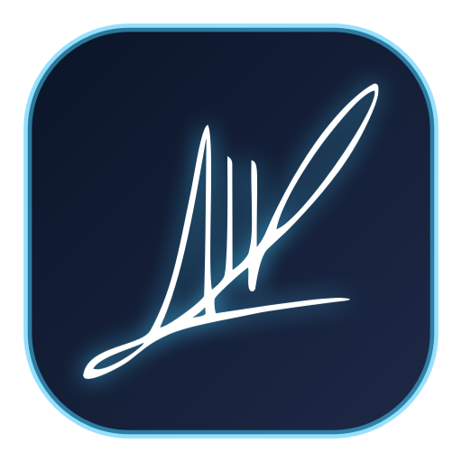
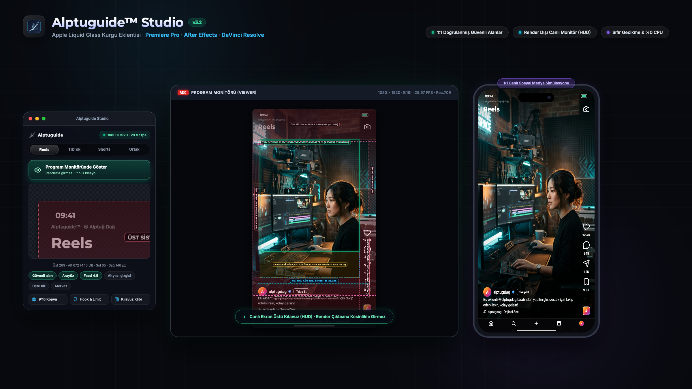
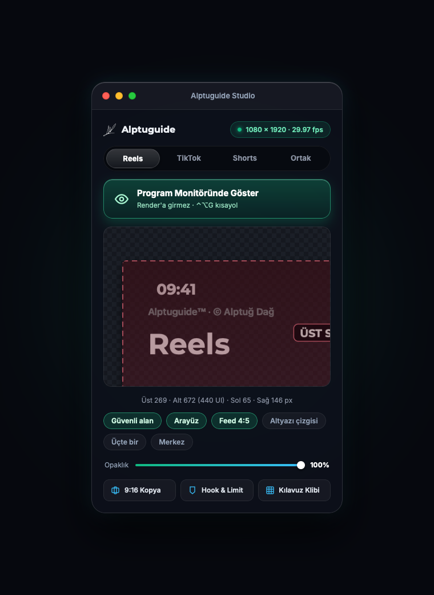
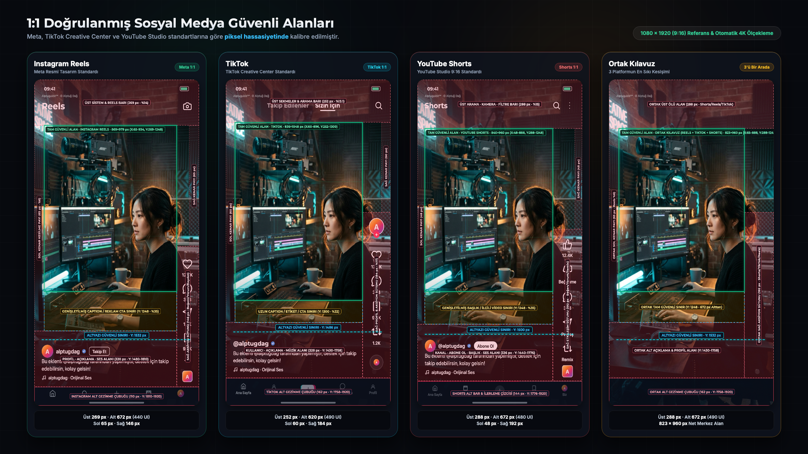

<p align="center">
  <picture>
    <source media="(prefers-color-scheme: dark)" srcset="assets/imza.svg">
    
  </picture>
</p>

<h1 align="center">Alptuguide™ Studio v3.2</h1>

<p align="center">
  <strong>Alptuguide™ Studio</strong>; dikey video prodüksiyonlarında (<strong>Instagram Reels</strong>, <strong>TikTok</strong>, <strong>YouTube Shorts</strong> ve <strong>3'lü Ortak Kesişim</strong>) birebir doğrulanmış güvenli alan kılavuzlarını ve canlı sosyal medya arayüz simülasyonunu <strong>Program Monitöründe render çıktısına girmeden</strong> sunan, ultra kompakt <strong>Apple Liquid Glass</strong> arayüzüne ve profesyonel kurgu araçlarına sahip çoklu platform (<strong>Adobe Premiere Pro</strong>, <strong>Adobe After Effects</strong>, <strong>DaVinci Resolve Studio</strong> ve <strong>macOS Native Studio</strong>) kurgu eklentisidir.
  <br><br>
  
  
  
  
  
  
</p>

<p align="center">
  Geliştirici: <strong>Alptuğ Dağ</strong> (<a href="https://github.com/AlptugDag">@alptugdag</a>)
</p>

---

<p align="center">
  
</p>

---

## Öne Çıkan Yenilikler ve Mimari (v3.2)

### 1. ⚡️ Gerçek Zamanlı Program Monitörü Kılavuzu (Render'a Asla Girmez)
Önceki sürümlerdeki ekran görüntüsü alma veya sürekli arka plan kare yakalama mantığı tamamen kaldırıldı; sıfır disk ve CPU/GPU yüküyle çalışır:
- **Tek Tıkla Monitör Önizlemesi ("Program Monitöründe Göster"):**
  - **After Effects**: Doğrudan aktif Composition içine yerel bir **Guide Layer** ekler. After Effects render motoru Guide Layer'ları çıktılarda kesinlikle render etmez.
  - **Premiere Pro & DaVinci Resolve**: Tıklamaları alta geçiren (`ignoresMouseEvents`) şeffaf, yerel macOS Liquid Glass overlay penceresi Program Monitörü / Viewer üzerine oturur. Timeline'a klip eklemediği için render'a asla girmez.
- **Global Kısayol (`⌃⌥G` / Control + Option + G):** Kurgu yazılımınızdan çıkmadan kılavuzu anında açıp kapatabilirsiniz.
- **Milimetrik Hizalama:** Ok tuşlarıyla `1 px` (Shift ile `10 px`) hassas kaydırma ve `+` / `-` tuşlarıyla anında ölçekleme.

<p align="center">
  
</p>

---

### 2. 💎 Ultra Kompakt & Tamamen Responsive Tasarım
- Panel içi tüm gereksiz host etiketleri, kafa karıştıran "Monitör: Canlı" ve "Canlı Monitör: Açık" butonları kaldırıldı.
- **Dinamik Boyutlanma:** Geniş pencerelerde önizleme ve kontroller yan yana iki sütun; dar pencerelerde dikey akış; zaman çizelgesi altına yerleştirilen çok kısa panellerde ise önizleme gizlenerek doğrudan kurgu araçlarına odaklanan akıllı düzen.
- Statik CSS cam gradyanları ve sıfır idle GPU tüketimi.

---

### 3. 🎬 Kurguculara Özel Yeni Profesyonel Araçlar
Bir profesyonel video kurgucusunun iş akışını hızlandıracak kritik yetenekler eklendi:
- **Gelişmiş Kompozisyon Kılavuzları:**
  - **Üçte Bir (Rule of Thirds):** Kadraj ve obje dengesi için 3x3 ızgara çizgileri.
  - **Merkez Artı (Center Crosshair):** Başlık ve logonun tam merkezlendiğinden emin olmak için.
  - **Broadcast Safe:** %90 Action Safe ve %80 Title Safe TV / yayın sınırları.
- **Kırpma Simülasyonları:**
  - **Feed 4:5:** Dikey Reels videolarının Instagram ve Facebook ana akışında (feed) üstten ve alttan nasıl kırpılacağını gösteren canlı maskeleme.
  - **Grid 3:4 & 1:1:** Profil ızgarasında videonun nasıl görüneceğini test etme.
- **Platform Süre Uyarıları & Hook Marker:**
  - Sekans süresi platform limitini aştığında (Reels 3 dk, Shorts 3 dk, TikTok 10 dk) sekans göstergesi anında kırmızı/sarı uyarı verir.
  - **"Hook & Limit":** Tek tıkla timeline'ın 3. saniyesine (izleyicinin videoda kalma karar anı) **HOOK** marker'ı ve süre aşılıyorsa limit uyarı marker'ı ekler.
- **9:16 Otomatik Kopya (Auto Reframe / Nested Comp):**
  - Orijinal sekansa dokunmadan, yatay veya kare videoyu tek tıkla 9:16 dikey sekansa dönüştürür (Premiere Pro'da Adobe Sensei Auto Reframe motoru, After Effects'te nested cover comp).
- **Timeline Temizleyici:**
  - Export öncesinde timeline'daki tüm Alptuguide önizleme ve kılavuz kliplerini tek tıkla temizler.

---

### 4. 📱 1:1 Doğrulanmış Sosyal Medya Güvenli Alanları
Platformların güncel resmi tasarım kılavuzları ve canlı testleri baz alınarak piksel hassasiyetinde (`1080 × 1920` referans, `4K 2160 × 3840` otomatik ölçek) kalibre edildi:

<p align="center">
  
</p>

| Platform | Üst Boşluk | Alt Boşluk (Tam / Organik UI) | Alt Nav Bar | Sol Boşluk | Sağ Aksiyon Sütunu | Altyazı Güvenli Y |
| :--- | :---: | :---: | :---: | :---: | :---: | :---: |
| **Instagram Reels** | `269 px` | `672 px` / `440 px` (`y: 1480`) | `110 px` (`y: 1810`) | `65 px` | `146 px` (`x: 934`) | `1420 px` |
| **TikTok** | `252 px` | `620 px` / `490 px` (`y: 1430`) | `162 px` (`y: 1758`) | `60 px` | `184 px` (`x: 896`) | `1375 px` |
| **YouTube Shorts** | `288 px` | `672 px` / `480 px` (`y: 1440`) | `144 px` (`y: 1776`) | `48 px` | `192 px` (`x: 888`) | `1385 px` |
| **Ortak (3 Platform)** | `288 px` | `672 px` / `490 px` (`y: 1430`) | `162 px` (`y: 1758`) | `65 px` | `192 px` (`x: 888`) | `1375 px` |

- **Instagram Reels (`reels`)**: Meta resmi standartlarına birebir uyumlu; üst `269 px` (`%14`), alt `672 px` (`%35` tam güvenli sınır) / `440 px` (`y: 1480..1810` organik açıklama + ses alanı) + `110 px` (`y: 1810..1920` alt navigasyon barı), sol `65 px` (`%6`), sağ `146 px` (`x: 934..1080` beğeni/yorum/kaydetme/paylaşım sütunu).
- **TikTok (`tiktok`)**: TikTok Creative Center standartlarına birebir uyumlu; üst `252 px` (`%13.1`), alt `620 px` (`%32` geniş açıklama) / `490 px` (`y: 1430..1758` organik kullanıcı/açıklama/ses alanı) + `162 px` (`y: 1758..1920` alt siyah navigasyon barı), sol `60 px`, sağ `184 px` (`x: 896..1080` sağ aksiyon sütunu ve dönen plak).
- **YouTube Shorts (`shorts`)**: YouTube Studio 9:16 standartlarına birebir uyumlu; üst `288 px` (`%15`), alt `672 px` (`%35` tam güvenli sınır) / `480 px` (`y: 1440..1776` kanal/Abone ol/başlık/ses alanı) + `144 px` (`y: 1776..1920` alt navigasyon barı ve kırmızı ilerleme çizgisi), sol `48 px`, sağ `192 px` (`x: 888..1080` sağ aksiyon sütunu).
- **Ortak Kılavuz (`all`)**: Tek videoyu aynı anda hem Reels, hem TikTok, hem YouTube Shorts'ta paylaşan içerik üreticileri için **3 platformun en sıkı kesişim alanı**:
  - Üst: `288 px` | Alt: `672 px` (Organik: `490 px`) | Sol: `65 px` | Sağ: `192 px`
  - **Net %100 Güvenli Merkez Alan**: `823 × 960 px` (`x: 65..888`, `y: 288..1248`) — Organik modda `823 × 1142 px` (`y: 288..1430`).

---

## Kurulum

```bash
git clone https://github.com/AlptugDag/Alptuguide.git
cd Alptuguide
./install.sh
```

Kurulum betiği (`./install.sh`):
1. **Adobe CEP Entegrasyonu**: Adobe `CSXS.9` – `CSXS.20` (`2020` – `2030+`) sürümleri için `PlayerDebugMode` ayarını otomatik açar ve eklentiyi `~/Library/Application Support/Adobe/CEP/extensions/com.alptug.alptuguide` dizinine kurar.
2. **DaVinci Resolve Entegrasyonu**: DaVinci Resolve Workflow Integration eklentisini ve `Fusion/Scripts` klasörlerine Python Studio betiklerini yerleştirir.
3. **Yerel macOS Uygulaması**: Evrensel (`arm64` + `x86_64`) ikiliyi derleyerek `/Applications/Alptuguide.app` konumuna yükler.

---

## Lisans

© 2026 **Alptuğ Dağ** (<a href="https://github.com/AlptugDag">@alptugdag</a>). Tüm hakları saklıdır.
